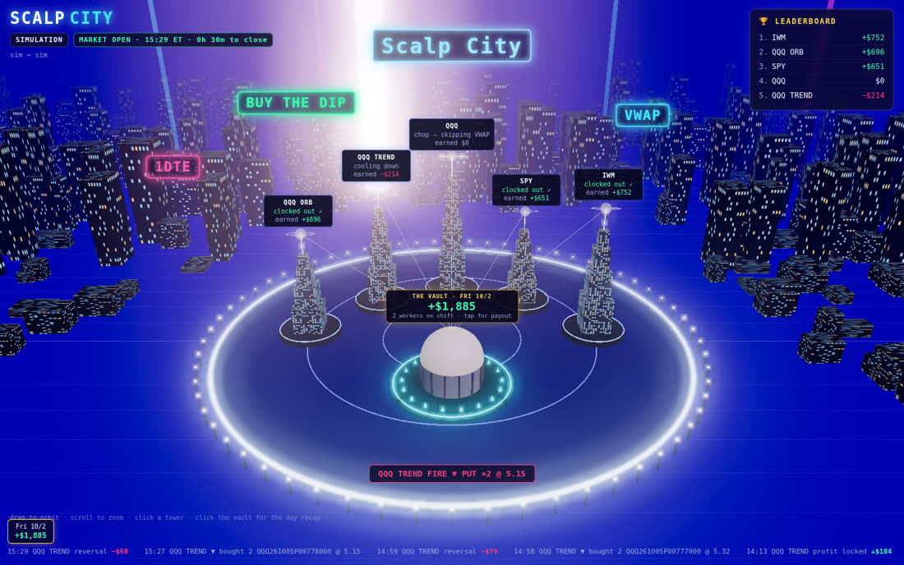
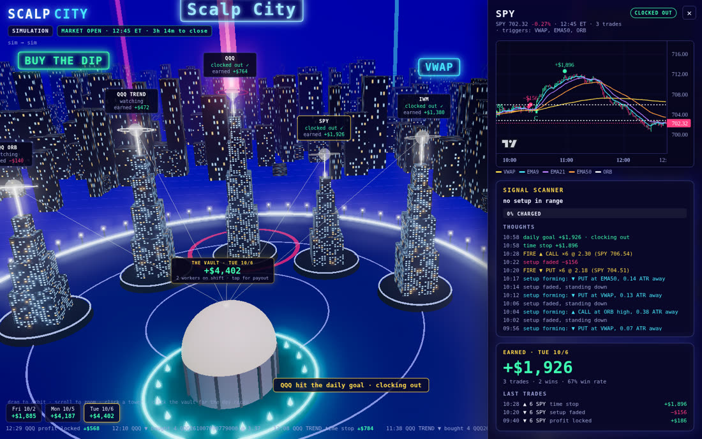

# Scalp City

Five Python bots that scalp **1DTE options** on QQQ, SPY and IWM off 1-minute candles. You watch them in a neon 3D city: each bot is a tower, its beam charges as price nears a trigger, and the vault in the middle holds the day's P&L. **Alpaca paper trading** is the test bed.



## What the bots do

| Worker | Underlying | Triggers |
|---|---|---|
| QQQ ORB | QQQ | 15-minute opening-range breakout |
| QQQ TREND | QQQ | 50 EMA cross |
| QQQ | QQQ | VWAP cross |
| SPY | SPY | VWAP, 50 EMA, ORB |
| IWM | IWM | VWAP, 50 EMA, ORB |

**Entry.** A 1-minute candle *closes* across VWAP, the 50 EMA, or the high/low of the first 15 minutes. A close above buys a call and a close below buys a put. The contract expires the next trading day (1DTE), with the strike at or next to the current price. Size is `budget_per_trade / (ask × 100)` contracts.

**Filters.**
- VWAP crosses are skipped while the 9 and 21 EMAs are squeezed together (chop).
- Each ORB side fires at most once a day.
- After every trade the worker waits a few minutes before taking another.

**Exits.**
- Stop loss on the option premium: *stopped out*.
- Trailing take-profit once the premium is up 25%: *profit locked*.
- The underlying closes back through the trigger: *reversal*.
- A max hold time, and flat by 15:55 ET.

**Daily limits.** A worker that reaches its daily goal *clocks out*. One that hits its daily max loss is *benched*.

All of these are settings in [`scalpcity/config.py`](scalpcity/config.py), and you can override them with a JSON file.

## Run it

```bash
cd scalp-city
pip install -r requirements.txt

# 1. Simulation: synthetic market, simulated fills, no keys needed
python -m scalpcity --mode sim --speed 0.3

# 2. Replay: real Alpaca 1-minute bars from past sessions, simulated fills
cp .env.example .env   # add your Alpaca paper keys
python -m scalpcity --mode replay --date 2026-09-28 --days 5 --speed 0.2

# 3. Paper: live Alpaca bars and real orders on your Alpaca *paper* account
python -m scalpcity --mode paper
```

Open http://127.0.0.1:8402.

### Alpaca setup

1. Create a free account at [alpaca.markets](https://alpaca.markets) and switch to **Paper Trading**.
2. Enable **options trading** for the paper account (level 2 or higher allows buying calls and puts).
3. Generate paper API keys and put them in `.env`.

Paper mode only ever builds `TradingClient(..., paper=True)`, so live trading is not wired up. It polls 1-minute bars a few seconds after each minute closes; the free plan uses the IEX feed, and you can set `ALPACA_DATA_FEED=sip` if you have a subscription. It looks up the next session's contracts and sends market `DAY` orders. On shutdown it closes any open bot positions.

### Using the dashboard

- Drag to orbit and scroll to zoom.
- Click a tower, or a name on the leaderboard, to open its panel. The panel shows a live chart (candles, VWAP, EMA 9/21/50, ORB lines, trade markers), the **signal scanner** (nearest trigger, distance in ATR, % charged), the bot's "thoughts" log, and today's trades.
- Beams glow **green** while a call setup is charging and **red** for a put. They flash when a bot fires, and a label floats up when it locks profit or gets stopped out.
- Click the vault for the day recap. The recap also pops up automatically at the close.
- The strip along the bottom is a calendar of daily results (saved in `data/history-<mode>.json`) plus a tape of fills.



### Custom config

```json
{
  "risk": { "budget_per_trade": 800, "daily_goal": 300, "stop_loss_pct": 0.15, "entry_end": "15:00" },
  "workers": [
    { "id": "qqq-vwap", "name": "QQQ", "symbol": "QQQ", "triggers": ["vwap"] },
    { "id": "spy-orb", "name": "SPY ORB", "symbol": "SPY", "triggers": ["orb"] }
  ]
}
```

```bash
python -m scalpcity --mode paper --config my-config.json
```

## Layout

```
scalpcity/
  indicators.py  EMA, Wilder ATR, session VWAP, opening range (incremental)
  strategy.py    Worker: triggers, chop filter, cooldown, exits, daily goal, scanner "charge"
  options.py     1DTE expiry, strike selection, OCC symbols, Black-Scholes
  broker.py      SimBroker (Black-Scholes fills) and AlpacaBroker (paper orders)
  feeds.py       SimFeed, AlpacaReplayFeed, AlpacaLiveFeed
  engine.py      runs the workers each minute, history, dashboard state
  server.py      FastAPI with a websocket state stream and chart API
web/             three.js city (bloom, CSS2D labels) + lightweight-charts panel
tests/           pytest suite (indicators, strategy, stubbed Alpaca broker)
```

```bash
python -m pytest -q
```

## Caveats

This is a test bed, not trading advice. Simulated results come from a synthetic random walk with trending regimes, and replay fills are priced with Black-Scholes at a fixed IV. Neither says anything about real performance. Use paper mode to see real spreads and fills before trusting any of it.
